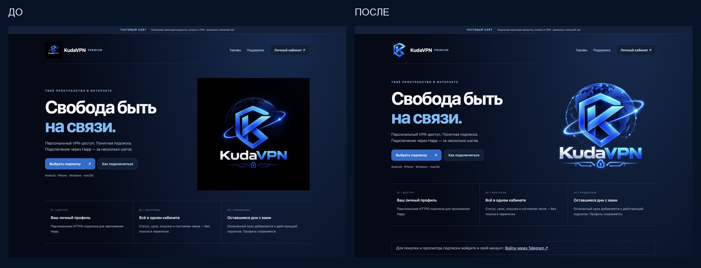
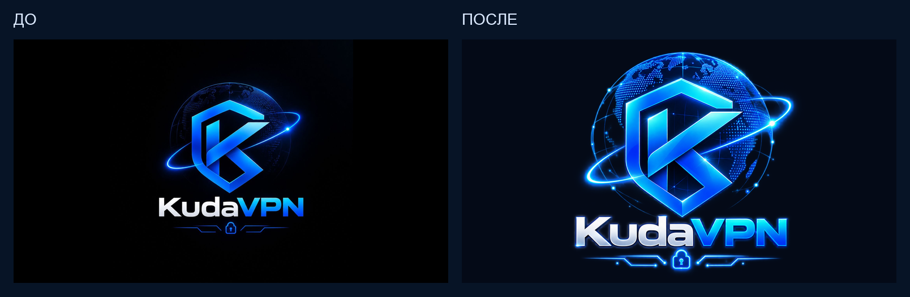

# KudaVPN: интеграция утверждённого PNG

30 октября 2026. Продолжение незавершённой работы в PR #29, поверх `4e41e0c`. **На серверы и ботов не применено.** Старые сравнения в `brand-preview/` — история JPEG-задания, не актуальные ресурсы.

## Готовое до возобновления и завершённое сейчас

В рабочем дереве уже находились точная копия PNG, новые изображения и компактная K, генератор ресурсов, переключение `bot/branding.py` и будущей профильной аватарки. Часть HTML/CSS уже имела новые пропорции и PNG srcset. Это сохранено, не откатывалось и не выполнялось заново.

Незавершёнными оставались тесты/README под прежний JPEG, stale handoff о недоступном файле и ссылка favicon страницы входа на отсутствующий публичный путь. Сейчас проверены новые файлы, исправлен favicon без изменения правил авторизации, обновлены тесты/документация, подготовлены локальный предпросмотр и сравнения.

## Эталон и размещение

`bot/assets/brand/original.png`: файл владельца «Киберлоготип KudaVPN с неоновым глобусом.png», **1367×1151 RGBA**, SHA256 `ea8160b3667452aceac8b3939308046dcf2585c57fd4f78d98f47bf84d5547d4`. Оригинальные байты сохранены. Alpha 0…254: 649621 полностью прозрачный пиксель и 923796 пикселей полупрозрачного изображения/свечения. Фон не вырезался, прозрачность настоящая.

| Компонент | Новый ресурс |
|---|---|
| Главная, кабинет/тарифы, вход, страница Happ | Полный PNG, естественные пропорции, все надписи/декоративные элементы сохранены |
| Шапки и компактные элементы | K из оригинальных пикселей, прозрачный PNG |
| Favicon | Та же K, ICO/PNG 32/64/128 |
| Checkout, документы/support (шесть site-шаблонов) | Наследуют общий реестр ресурсов, тексты и действия не менялись |
| Общий приветственный ресурс | Полный логотип на тёмно-синем поле 1280×720 |
| BotFather / профиль | Подготовлены полный 640×360 и квадратная K; API не вызывался |

Выделение K — выбор области исходных пикселей, не приближённая SVG-копия. Контур/рамка и восьмипиксельный запас записаны в manifest. RGB не перерисован, исходные детали сетки и свечения внутри знака сохранены. Веб-PNG и ICO сохраняют alpha. Только технические Telegram photo/profile изображения и старый JPEG URL сведены на фон #040a17; существующий помощник профиля принимает JPEG. Эти JPEG не используются новыми HTML-шаблонами и не являются эталоном. Старый квадратный JPEG удалён из текущих ресурсов.

Высокая плотность экрана: PNG 1024px и полный исходник через srcset. Legacy image URLs совместимы, но отдают производные нового PNG. Favicon входа использует статический вариант `/auth/assets/logo.png?variant=icon`; список публичных путей, middleware, identity, login/callback, сессии и CSRF не менялись. AST-сравнение с HEAD подтвердило, что в website.py отличается только визуальный login_asset (кроме охватывающей функции приложения). Неизвестный variant даёт 404, произвольные пути не принимаются.

## Изменённые файлы

- `bot/branding.py`, `bot/assets/brand/*`, `scripts/build_brand_assets.py`: единственный эталон, производные, manifest и воспроизводимые параметры.
- `bot/subscription_api/connect_page.py`, `static/{website,website-login}.html`, `static/{website,connect}.css`, `bot/subscription_api/website.py`: изображения, размеры и статический favicon.
- `deploy/telegram-pilot/profile.json`, `update_profile.py`: путь JPEG-аватарки и проверка SHA256 по manifest; production identity guard сохранён. Помощник не запускался.
- `tests/test_brand_assets.py`, `test_bot_public_profile.py`, `test_website.py`: новые ресурсы, варианты и приватность.
- README, этот отчёт, handoff, `docs/brand-png-preview/*`: актуальное состояние и визуальные доказательства.

## Результаты проверки

**158 профильных тестов passed, 0 skipped**: brand assets, profile safety, connection page/JS clipboard, pilot welcome, повторный start/меню, custom emoji navigation, website/OIDC/review и прежний checkout с фиктивными платежами. Только временная SQLite и локальные HTTP-сокеты; production PostgreSQL, VPN, ЮKassa и Telegram не используются. Полный аудит проекта повторно не выполнялся.

Проверены SHA256/alpha, пиксели полных производных, сохранение выбранных RGB-пикселей K, отсутствие искусственного усиления alpha, размеры/центрирование, ICO frames, все asset URLs и legacy aliases, favicon до входа, блокировка чужих/анонимных данных и неверных variants. `build_brand_assets.py --check` прошёл без перезаписи.

Браузерные размеры **1440×1000, 390×844, 375×812, 320×740**: изображения загружены, object-fit=contain, горизонтального переполнения нет. Кабинет и открытый QR проверены на явно вымышленных данных, личных ссылок в скриншотах нет. Это **не физические Android/iPhone и не живой Telegram-клиент**.

[Вход до/после](brand-png-preview/login-before-after.png), [сайт 390px](brand-png-preview/site-390.png), [кабинет 375px, fixture](brand-png-preview/account-375-fixture.png), [Happ/QR 375px, fixture](brand-png-preview/connect-375-fixture.png), [полный набор и K](brand-png-preview/asset-preview.png), [запись проверки](brand-png-preview/validation.json).

Предпросмотр: http://127.0.0.1:18118/ — только локальная имитация, без настоящих покупок/подписки. Скриншоты и ZIP в `/private/tmp/kuda-brand-v2/`. Наружу не опубликован.

## Оставшееся и безопасное внедрение

- Сначала утверждение внешнего вида владельцем. Затем отдельное согласование backup/rollback и обновления только нужных тестовых компонентов.
- Тестовый бот обновлять визуальным overlay существующего runtime с ресурсами. Нельзя запускать всю ветку сайта как бота (другой DB head). Старый update_menu.py копирует прежние UI-файлы, не является установщиком этого набора; его защитные ограничения не расширялись.
- Баннер общий в исходниках, но отправка ограничена существующим opt-in пилотного onboarding. Флаги и логика основного бота не менялись; отдельного старого photo-banner в непилотной ветке start нет. Включение новой отправки основному боту не выдаётся за сделанную замену ресурса.
- BotFather и любые реальные вызовы профиля Bot API — только по отдельному разрешению. Старые Telegram-фото автоматически не заменяются, историю и onboarding не сбрасывали.
- После разрешённого rollout: first-start отдельным тестовым аккаунтом и реальный просмотр Android/iOS/Desktop. До этого не заявлять живой Telegram E2E.

Xray, UUID, HTTPS/Happ-ссылки, платежи, production/DO, PostgreSQL, Monitor и резервирование не менялись. Рабочие сервисы не перезапускались, миграции не выполнялись. Временный локальный demo/SQLite не является рабочей базой.
