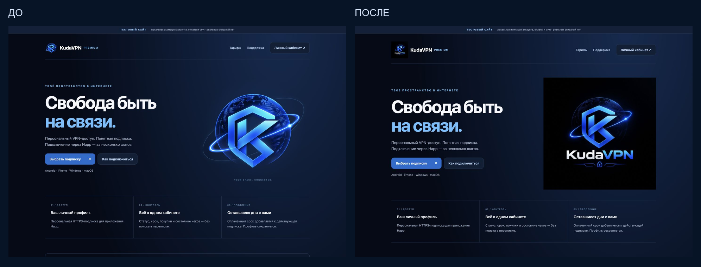
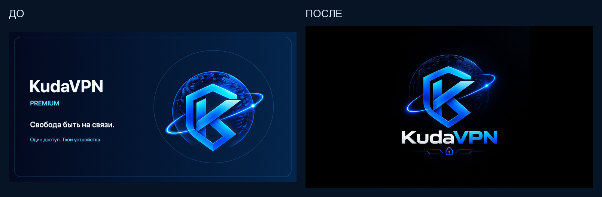

# Единый оригинальный логотип KudaVPN

30 октября 2026. Изменения только в исходниках и локальном предпросмотре, **не развёрнуты**. Рабочие серверы, Monitor, резервирование, базы, UUID, ссылки Happ и платёжные настройки не менялись. Новые изображения не генерировались и не рисовались.

## Эталон и аудит

Приложенный владельцем `photo_2026-10-29 23.16.30.jpeg`: 1254×1254, SHA256 `084ba43d6f5cd0ae8e51c6896db141dd9c78f0d80807917ef8917becaeda2337`. Он побайтово совпал с прежними `static/kudavpn-original-logo.jpeg` и `bot/assets/telegram-avatar-original.jpg`. Проблема была не в этих JPEG, а в отдельных производных и способах отображения.

| Место | Обнаружено | Подготовленное изменение |
|---|---|---|
| Основной независимый сайт и тестовый сайт | Один общий website.html; header/hero использовали вырезанную эмблему | Единый реестр ресурсов, полный оригинал в header/hero/footer; исходный JPEG доступен для Retina через srcset |
| Авторизация | /auth/assets/logo.png отдавал вырезанную эмблему 720×720 | Пропорциональная полная копия, публичный путь и whitelist авторизации не изменены |
| Личный кабинет, тарифы, подписки, история заказов | Общая страница website.html с переключаемыми разделами | Тот же фирменный header; данные/платёжные действия не менялись |
| Отдельный HTTPS-checkout | checkout/assets/logo.png с прежней эмблемой | Те же общие ресурсы и favicon; код оплаты не менялся |
| Страница подключения Happ | Вырезанная эмблема, тень, дополнительная движущаяся орбита | Полный оригинал без дополнительных орбит, recolor, маски и обрезки; платформа, ссылка и QR сохранены |
| Условия, оферта, конфиденциальность, продавец, оплата/возврат, поддержка | Текстовый header без изображения | Общий компактный полный логотип и favicon; юридические тексты не редактировались |
| Первое приветствие бота | Составной welcome-premium.png: отдельный знак + заново набранная надпись | telegram-welcome.png из полного оригинала, с боковыми полями; caption/клавиатуры/first-start ledger не менялись |
| Прочие сообщения бота | Фирменные custom emoji и текст, отдельных фото-логотипов не найдено | Технические иконки, идентификаторы и сообщения сохранены |
| Аватарка / BotFather | Дубликат правильного JPEG; внешние изображения не управляются исходниками автоматически | Конфигурация ссылается на один оригинал; подготовлены avatar-1024.png и description-640x360.png |
| Favicon | Явного общего favicon не было | ICO 32/64/128, PNG 32/64/128; полный логотип с полями, без вырезания K |
| Статический макет в docs и Swift preview | Старый составной баннер/фиксированная растянутая рамка | HTML показывает текущий полный баннер; Swift preview масштабирует пропорционально |

Логотипы сторонних сервисов, пользовательские кнопки и наборы custom emoji не заменялись. Исторические отчёты проекта сохранены как история: их старые имена ресурсов не означают, что прежняя графика используется runtime.

## Единый источник и файлы

- Единственный оригинал: `bot/assets/brand/original.jpeg`, без перекодирования. Два старых дубликата заменены одним файлом.
- Реестр: `bot/branding.py`; производные, размеры и хэши: `bot/assets/brand/manifest.json`, описание: `bot/assets/brand/README.md`.
- Генератор: `scripts/build_brand_assets.py`, только contain/LANCZOS, центрирование и поля. Старый генератор `scripts/render_welcome_banner.swift` удалён, чтобы не создавать новую независимую композицию.
- Широкие PNG: 1280×720 Telegram и строго 640×360 BotFather. Квадратные PNG: 1024, 512, 192 и favicon 32/64/128. Оригинальный чёрный непрозрачный фон сохранён; прозрачность не изобреталась.
- Старые HTTP URL `kudavpn-original-logo.jpeg` и `kudavpn-orbit-emblem.png` остаются рабочими alias, но второй теперь отдаёт полную пропорциональную копию. Старый вырезанный PNG физически удалён. Файловые пути из старых инструкций не использовать.
- PNG 512 около 128 KiB вместо прежнего PNG-эмблемы около 537 KiB; JPEG для экранов высокой плотности — около 85 KiB. Новый баннер около 224 KiB вместо прежних 825 KiB. Pillow добавлен только в requirements-dev; production-зависимости не изменены.

Изменённые display-компоненты: `bot/handlers/start.py` (только ссылка BANNER), `bot/subscription_api/{app,website,checkout_web,connect_page}.py` (только изображения), `static/{website,website-login,checkout,connect}.{html,css}` по существующему набору файлов, шесть `site-*.html`. В metadata-helper `deploy/telegram-pilot/update_profile.py` и profile.json изменён только путь/проверка эталонной аватарки. Дополнены `tests/test_brand_assets.py`, `tests/test_connection_page.py`, `tests/test_bot_public_profile.py`. Полный список — в отдельном коммите этой задачи.

## Проверки и демонстрация

**155 различных профильных тестов прошли**, без итоговых пропусков. Сначала 149 тестов брендинга, профиля, onboarding, navigation, website/review/checkout; затем три дополнительных HTTP-контракта и три JS-проверки копирования ссылки Happ. Три JS-теста первоначально пропускались из-за отсутствия node в PATH; после подключения уже установленного Node все три прошли. HTTP-тесты используют loopback и временную SQLite, не рабочие данные. Блокировка bind в песочнице устранена разрешением на локальные тестовые сокеты; проверки безопасности приложений не отключались.

Проверены SHA256 оригинала, пиксели каждого PNG относительно полного пропорционально уменьшенного исходника, поля, отсутствие перекраски/обрезки, размеры ICO, реальные ответы всех трёх asset handlers, совместимые старые URL, CSP/private headers, первое/повторное приветствие и сохранение действующих сценариев авторизации/подписки/оплаты. Повторная генерация `--check` успешна.

Браузерные viewport-проверки: 1440×1000, 390×844, 375×812, 320×740. Все видимые логотипы имеют квадратные пропорции, object-fit=contain, изображения загрузились, горизонтального переполнения нет. Кабинет и открытый QR проверены только на явных fixture-данных. Это **не проверка физических Android/iPhone или живого Telegram-клиента**. [Точная запись проверки](brand-preview/validation.json).

[Вход на 390 px](brand-preview/login-390.png), [Happ и QR на 375 px, вымышленные данные](brand-preview/connect-375-fixture.png). Локальные дополнительные скриншоты и ZIP находятся в `/private/tmp/kuda-brand-preview/`. Локальный website preview: `http://127.0.0.1:18118/`, только имитация, никаких настоящих карт/покупок.

## Что нельзя обновить автоматически в этой задаче

- Ни production, ни тестовые серверы/боты не обновлялись. Нужен отдельный этап после согласования визуального результата.
- Для тестового бота нельзя запускать целиком ветку сайта: у неё другой DB head. Старый `deploy/telegram-pilot/update_menu.py` копирует только прежние шесть UI-файлов, поэтому для будущего обновления нужен отдельно проверенный визуальный overlay с `bot/branding.py` и новыми ресурсами. Не расширять его защитные исключения вслепую. Текущая задача не меняет этот установщик и его ограничения.
- Уже отправленные фото-баннеры Telegram и кэшированные аватарки не заменяются изменением файлов. История, сообщения и onboarding не удалялись/не сбрасывались.
- Description picture в BotFather: подготовленный `description-640x360.png` нужно загрузить отдельно. При необходимости для аватарки есть `avatar-1024.png`; исходная действующая аватарка уже использовала тот же оригинал по конфигурации, фактическая Bot API-проверка в этой задаче не проводилась.
- Логотипы во внешних кабинетах/на чужих платёжных страницах, если они там установлены, не управляются этим репозиторием. Настройки ЮKassa не проверялись и не менялись.

После согласования: визуальный overlay только тестового бота и отдельных HTTPS-компонентов с backup/rollback и прежними конфигурациями; реальный first-start на отдельном тестовом аккаунте и просмотр Android/iOS/Desktop. Production — только после отдельного разрешения.
