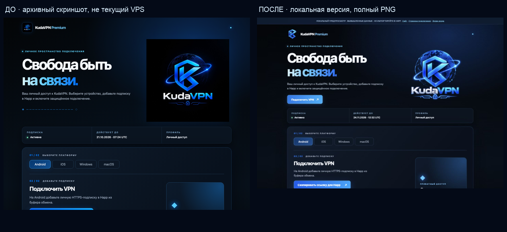

# KudaVPN — восстановленный локальный предпросмотр, 30 октября 2026

Работа в существующей ветке PR #29, поверх `7d92691`. Серверы и Bot API не использовались. Действующие шаблоны, логика авторизации/платежей, VPN/UUID/Happ, базы, Monitor и backups не менялись.

## Причина недоступности

На старте на `127.0.0.1:18118` не было listener: HTTP-сервер остановлен. Прежняя worktree `/private/tmp/kudavpn-site-v1-20261026` отсутствовала, Git показывал её как prunable. Причину удаления временной папки установить по имеющимся данным нельзя; утверждать конкретную перезагрузку/очистку не следует. Коммит `7d92691` оставался локально и в GitHub, незакоммиченные изменения в сохранившейся основной worktree не трогали.

Та же ветка восстановлена в постоянную папку `/Users/gr/Documents/KudaVPN-preview`. Создано отдельное локальное `.preview-venv`, в Git не попадает. Никаких launchd/systemd-служб или публикации в интернет. Процесс слушает **только 127.0.0.1:18118**. Сейчас он запущен через локальный процесс Codex; автоматизация нативного Terminal недоступна инструменту. Сам command-файл реально запущен и проверен; владелец может открыть его двойным щелчком для независимого от Codex окна Terminal. После завершения Terminal/Codex или перезагрузки процесс может остановиться; повторный запуск ниже.

## Запуск на Mac

Дважды нажмите в Finder `scripts/start_local_preview.command` либо выполните в Terminal:

```sh
/Users/gr/Documents/KudaVPN-preview/scripts/start_local_preview.command
```

Оставьте окно открытым; Ctrl+C завершает только локальное демо. Не запускайте вторую копию, пока порт занят. Настройки VPN, прокси и безопасность Mac менять не требуется.

- Главная: http://127.0.0.1:18118/
- Подключение: http://127.0.0.1:18118/__demo__/connect
- Вид экрана входа: http://127.0.0.1:18118/__demo__/login-screen
- Вымышленный аккаунт: http://127.0.0.1:18118/__demo__/login

Все данные/QR/оплата вымышленные, не импортировать в Happ. Прямая визуальная страница подключения не создаёт подписку и не авторизует личные API. Настоящий `/connect`, `/api/account` и feed по-прежнему требуют локальную fixture-сессию. Реальный Telegram OAuth, ЮKassa и узлы в этом демо не вызываются. Никакие `.env` или приватные файлы не читаются.

При новом клонировании вместо уже подготовленной worktree: Python 3.12, затем из корня проекта `python3 -m venv .preview-venv` и `.preview-venv/bin/python -m pip install -r bot/requirements.txt -r bot/requirements-dev.txt Pillow==12.3.0`. TLS-проверку пакетов не отключать. Это только локальные инструменты, не установка на VPS.

## Утверждённый логотип и повторная проверка использования

Повторно приложенный владельцем PNG побайтово совпал с `bot/assets/brand/original.png`: SHA256 `ea8160b3667452aceac8b3939308046dcf2585c57fd4f78d98f47bf84d5547d4`,1367×1151 RGBA, настоящий alpha0..254. Эталон/цвета/композицию не меняли и заново не генерировали.

| Интерфейс | Текущий источник в коде |
|---|---|
| Главная / крупный hero | `logo.png`/srcset → полный PNG |
| Отдельная страница «Свобода быть на связи» и инструкции Happ | `connect_page.py`, тот же полный PNG, без подложки/рамки/обрезки |
| Вход | `auth/assets/logo.png`, полный PNG |
| Кабинет / тарифы / покупка / продление | общий website.html, компактная K в шапке; отдельного большого устаревшего логотипа нет |
| Прежний отдельный checkout | общий реестр `bot/branding.py`, полный PNG |
| Поддержка / юридические и информационные страницы | общие компактная K/favicon; тексты не редактировались |
| Первое Telegram-приветствие / BotFather-баннер | полный `telegram-welcome.png` / `description-640x360.png`, уже подготовлены в7d92691 |
| Шапка / favicon / аватарка | существующая компактная K из оригинальных пикселей |

Повторной замены уже исправленного кода не делали. Крупный логотип на странице подключения **уже исправлен в7d92691**, что подтверждено живым локальным HTTP/браузером. По handoff эти ресурсы ещё не развёрнуты на VPS: местная версия и ранее установленная версия могут различаться. Текущая задача не разрешает устранить различие на JustHost. Удалённых проверок не проводили.

Старые имена URL сохраняются как aliases реестра: `kudavpn-orbit-emblem.png` отдаёт полный PNG, `kudavpn-original-logo.jpeg` — техническую JPEG-копию нового PNG. Текущие HTML JPEG не запрашивают. Архивные картинки в документации сохранены как история. Новые/старые custom emoji и сторонние значки не менялись. Уже отправленные фотографии Telegram и профиль BotFather локальным Git не обновляются.

## Проверки

**54 passed /0 skipped**: `test_local_website_preview.py`, `test_brand_assets.py`, `test_connection_page.py`, `test_pilot_welcome.py`, `test_start_without_hint.py`, `test_start_premium_menu.py`, `test_registered_emoji_navigation.py`. В том числе4 новых HTTP-сценария: HTML/CSS/JS/image URLs, полный hero, тарифы199/499/1790, отсутствие созданных платежей/подписок, сохранение авторизации персональных маршрутов. Нормальный полный local suite не повторялся. Предыдущие158 тестов и CI7d92691 сохранены как исторический результат, не суммировать их с54.

GitHub CI для кодового коммита `d443d27`: [run41056941088](https://github.com/Denis-hud-dev/vpn-service/actions/runs/41056941088), job test завершён успешно, включая hygiene/syntax/smoke/одноразовый PostgreSQL. Последующая правка обновляет только скриншоты после завершения анимации; размеры PNG/JPEG сверены с запрошенными viewport.

`build_brand_assets.py --check`, `pip check`, `sh -n`, `git diff --check` прошли. HTTP `/`, `/__demo__/connect`, `/assets/logo.png` →200. Все запрошенные HTML-ресурсы в новых HTTP-тестах →200 с nosniff/private headers.

Главная и страница подключения проверены на1440/390/375/320px:0 сломанных изображений, scrollWidth равен viewport, полный hero без обрезки. Вход/кабинет375px:0 переполнения. QR открывается, один локальный SVG. DOM-измерения: [подключение](local-brand-preview/responsive.json), [главная](local-brand-preview/site-responsive.json).

Safari и Google Chrome на Mac реально открыли локальную страницу подключения, показали полный логотип/стили/элементы инструкции; скриншоты сохранены локально. Точное mobile-size измерение сделано в IAB, не на физических Android/iPhone. Живой Telegram-клиент и серверный OAuth в этой сессии не тестировали. Платёжные и остальные функции исходного сайта не изменены.

## Скриншоты

[Сравнение до/после](local-brand-preview/connect-before-after.png) использует архивный `docs/screenshots/premium-connect-desktop.png` слева и новую локальную страницу справа; это **не новый снимок действующего VPS**. Старый кадр содержит прежнее полное изображение с квадратным фоном; он не выдается за доказательство текущего случая «только K» на удалённом стенде.



[Мобильный вид390](local-brand-preview/connect-390.jpg), [375](local-brand-preview/connect-375.jpg), [320](local-brand-preview/connect-320.jpg), [QR375](local-brand-preview/connect-qr-375.jpg), [главная1440](local-brand-preview/site-1440.jpg), [главная390](local-brand-preview/site-390.jpg), [вход375](local-brand-preview/login-375.jpg), [кабинет375](local-brand-preview/account-375.jpg).

## Изменённые файлы этой сессии

- `.gitignore`: только локальные окружения.
- `scripts/preview_website.py`: навигация и визуальные fixture-маршруты только демо.
- `scripts/start_local_preview.command`: повторный foreground-запуск.
- `tests/test_local_website_preview.py`:4 новых сценария.
- `docs/local-brand-preview-20261030.md`, `docs/local-brand-preview/*`: отчёт/скриншоты/измерения.
- `docs/WORK_SESSION_HANDOFF.md`: актуальная точка продолжения.

## Безопасное последующее обновление

Сначала владелец утверждает внешний вид и отдельно разрешает обновление конкретного тестового HTTPS-сервиса и тестового бота. Затем backup/rollback, visual-only overlay общей графики/registry/шаблонов с контролем прежних конфигураций/UUID/ссылок и профильной приёмкой. Нельзя запускать весь PR29 как бот: DB head отличается. Старый update_menu.py не является установщиком этого набора. Profile Bot API/BotFather требует отдельного разрешения. Production/VPN/Monitor/backup-процессы не перезапускались и не изменялись.
