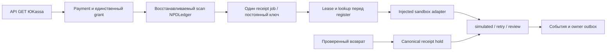

# Независимый НПД-реестр и sandbox-очередь

28 октября 2026. PR29, только source/offline. Серверы, ключи и подписки не изменялись, сведения в ФНС/провайдерам не отправлялись. Реальные и рекуррентные списания выключены.

## Повторное использование

Существующий NPDLedger перенесён в `bot/services/npd_receipts.py`; импорт `website.NPDLedger` совместим. Таблицы receipt/event и канонические Payment/User/Subscription/grant сохранены. Очередь читает платёж, покупателя, тариф, сумму, валюту и paid_at из них, не создаёт вторую платёжную систему.

Подготовлены additive таблицы: `npd_receipt_jobs` (один job/ключ на платёж, состояние, попытки, due/lease, приватная simulation-ссылка), `npd_receipt_holds` (проверенный возврат и ручной review), `npd_admin_alerts` (owner-only outbox). Миграция0010 проверяется только на disposable БД. Рабочие canonical0008/auth0009 не мигрировались; обычный UI-overlay не подходит для этих backend-изменений.

Scan восстанавливает пропущенный callback после оплаченного grant. До dispatch требуются история фактической выдачи, корректные сумма/валюта/test receipt. Pending/canceled заказ ничего не регистрирует. PK/unique дают один job; продление по-прежнему защищено существующим SubscriptionService.

## Ограничения и восстановление

NPDQueue default off. Нет HTTP/FNS клиента, startup/systemd регистрации или реального Telegram sender. Разрешены только tmpSQLite либо утверждённый localhost/kudavpn_telegram_pilot с тестовой ролью и adapter.environment=sandbox. Production/чужая БД отвергается. Пароль «Моего налога» не используется.

Conditional UPDATE выдаёт lease на2минуты. Tick ограничен по jobs, вызовы адаптера —20секундами. Retry с задержкой; после5 ошибок/незавершённых проверок — ручной review. Lookup по постоянному ключу восстанавливает «операция у провайдера прошла, процесс упал до записи». Async pending опрашивается без новой регистрации. Реальный exactly-once требует документированных idempotency/lookup выбранного партнёра: mock не заменяет контракт.

Sandbox success = job `simulated` и event `sandbox_registered`. **NPDReceipt остаётся test_not_required**, не issued/delivered. Принимаются только явно simulated результаты с совпадающими ключом/суммой и HTTPS-ссылкой `*.invalid`. Настоящая ссылка ФНС не выдаётся за симуляцию. Регистрация и доставка реального чека покупателю не реализованы.

Ошибки — фиксированные коды, без исключения/ответа провайдера. `details(owner,payment_id)` проверяет владельца. Ссылки не попадают в общие уведомления/логи. Администратору — тип проблемы и case hash; unique key/lease подавляют обычные повторы. Ошибки отправки повторяются. После «Telegram принял, процесс упал до sent» возможен дубль: exactly-once sendMessage не обещаем. Реальная отправка не подключена, tests используют AsyncMock; Monitor не затронут.

## Возвраты и настоящие документы

Решение владельца: ручной разбор без автоматического уменьшения срока/отзыва UUID. Optional `receipt_queue` в TestRefundProcessor вызывается только после независимой проверки refund и parent. Canonical hold возможен до создания job, дубли идемпотентны, несовпадающие идентификаторы отвергаются. Hold блокирует dispatch и устаревший in-flight success. Это не аннулирование чека и не изменение VPN-доступа.

NPDLedger.record требует отдельное `annulment_confirmed` для уже зарегистрированного документа и запрещает смену его identity. Без фактической регистрации/доставки/аннулирования итоговый статус выставлять нельзя.

Глобальная refund/subscription транзакция всех bridge/poller/webhook остаётся отдельной интеграционной задачей. Optional hook не подключается автоматически. Нужно согласовать также доставку настоящего чека, контакты/согласия и налоговый SLA.

## Проверки и продолжение

119 профильных tests passed/1 local PostgreSQL skip; дополнительно1 verified-refund→hold integration passed. Проверены duplicate без второго grant/job, owner guard, ошибки/backoff/alert/предел попыток, provider commit→crash→lookup, конкурирующие workers/outbox, async pending, refund до/во время dispatch, конфликт refund, подтверждение аннулирования, additive миграции/metadata. Полный локальный набор не повторялся; CI фиксируется после публикации.

Следующий шаг: по [сравнению провайдеров](npd-provider-comparison-20261028.md) получить подтверждение cheque-only внешней ЮKassa, sandbox/API/idempotency/доставки/цены. Затем согласовать isolated canonical схему и провести PostgreSQL-приёмку общей очереди/операторского refund-review. Пока не подключать live adapter, ФНС и реальные платежи. Перед будущим server rollout обязательны backup/rollback; текущая сессия серверы не обновляет.
